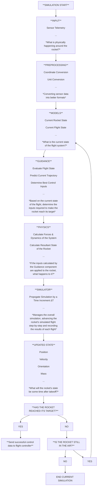

>NOTE: This project is **very** early in its programming stages 

### About Icarus
This program is designed to be a simple implementation of atmospheric dynamics for rockets, with the core goal of guiding self-propelled vertical rocket landings (a-la SpaceX).  To achieve this, Icarus is built on a foundation of various different individually configurable "modules", allowing parameters to be set for the exact type of rocket, fuel, takeoff, and target landing positions.  These parameters are then passed into a single Dynamics function, which will calculate the state of the system after a specific amount of time, iterating until a target time is found for *when* and *how long* to fire the boosters for landing.

